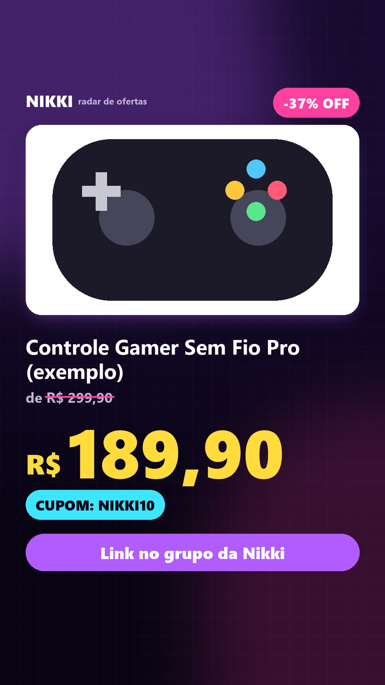

# Automação de Redes Sociais


**Pipeline de automação de conteúdo para redes sociais**, construído para a Nikki, uma persona digital geek/gamer que garimpa promoções.
Uma promoção entra por webhook e, sem nenhuma intervenção humana, vira arte, vídeo e legenda adaptada para
cada rede. Em seguida é publicada no **Instagram, Facebook, TikTok e YouTube**, cada post direcionando para o
grupo de WhatsApp certo, com o resultado registrado.

<p align="center">
  
  
</p>

## O que ele faz

```
POST /api/promotions
   └─▶ validação ─▶ normalização ─▶ deduplicação/idempotência ─▶ persistência
         └─▶ score 0–100 ─▶ escolha de redes/formatos ─▶ copy por rede (persona da Nikki)
               └─▶ arte feed/story ─▶ vídeo vertical (ffmpeg) ─▶ grupo WhatsApp por rede
                     └─▶ fila de publicação ─▶ APIs oficiais ─▶ status, URL pública, métricas
```

- **Idempotente:** webhooks repetidos nunca geram post duplicado (chave `store + external_id`, mesma URL
  canônica e queda real de preço dentro de uma janela de tempo).
- **Score configurável:** desconto sozinho não basta. O score combina preço, relevância, confiabilidade
  da loja, cupom, imagem e potencial de conteúdo, com pesos em `config/rules.yaml`.
- **Distribuição por tier:** promoções medianas não poluem todas as redes; as melhores viram vídeo.
- **Conteúdo agregado:** "5 achadinhos de hoje", "Top TCG" etc. viram vídeo automaticamente em horários definidos.
- **Falha parcial isolada:** se o TikTok falhar, o Instagram sai do mesmo jeito. Há retry com backoff
  exponencial e limite de tentativas, e erros são classificados como `retryable`/`non_retryable`.
- **Roteamento determinístico:** cada rede só divulga o próprio grupo de WhatsApp. Uma trava
  (`assert_text_routes_correctly`) bloqueia qualquer legenda que cite o grupo de outra rede.
- **Travas de segurança:** o Facebook só publica na Página da marca, nunca no perfil pessoal. O YouTube só publica
  no canal da marca (o canal é verificado no OAuth e antes de cada upload).
- **Painel local:** promoções, scores, status por rede, links publicados, erros e reprocessamento com um clique.

<p align="center">
  
</p>

## Destaques técnicos

| Tema | Como foi resolvido |
|---|---|
| Fila sem infraestrutura extra | Fila persistida no SQLite (WAL) + worker em thread; jobs independentes por rede/formato |
| Publicação | Clientes próprios para Meta Graph API, YouTube Data API v3 e TikTok Content Posting API (upload resumível/em chunks) |
| Imagens no Instagram | O IG exige URL pública: a imagem é hospedada como foto *não publicada* da própria Página (CDN da Meta) |
| OAuth | PKCE em todos os provedores, tokens só no banco local, nunca em log (redação automática de segredos) |
| Arte | Renderizador Pillow com layout adaptativo: o preço encolhe até caber e o card do produto cede espaço ao texto |
| Vídeo | ffmpeg embutido (`imageio-ffmpeg`): zoom suave, transições e trilha de áudio, a custo zero |
| Operação no Windows | Supervisor PowerShell que reinicia o processo com backoff; `start/stop/status.ps1` |

### QA visual automatizado

Os preços de R$ 9,90 a R$ 12.999,90 nunca sobrepõem o "R$" e respeitam as *safe areas* do story:

<p align="center"></p>

## Stack

Python 3.12 · FastAPI · Pydantic v2 · SQLAlchemy 2 · httpx · Pillow · ffmpeg · pytest (110+ testes)

## Rodando localmente

```powershell
py -3.12 -m venv .venv
.venv\Scripts\pip install -r requirements.txt
copy .env.example .env
copy config\whatsapp_groups.example.yaml config\whatsapp_groups.yaml
.venv\Scripts\python -m pytest
scripts\start.ps1        # painel em http://127.0.0.1:8710
.venv\Scripts\python -m nikki send tests\fixtures\promotion_amazon.json
```

Com `NIKKI_PUBLISHER=dry_run` nada é publicado: os posts vão para `data/outbox/`.

## Documentação

[Arquitetura](ARCHITECTURE.md) · [Decisões](DECISIONS.md) · [Operação](OPERATIONS.md) ·
[Integrações](docs/integrations.md) · [Regras de conteúdo](docs/content-rules.md) · [Roteamento WhatsApp](docs/whatsapp-routing.md)

---

Termos de Uso e Política de Privacidade do app: [termos](https://the-oliveira.github.io/automacao-redes-sociais/termos.html) ·
[privacidade](https://the-oliveira.github.io/automacao-redes-sociais/privacidade.html)
